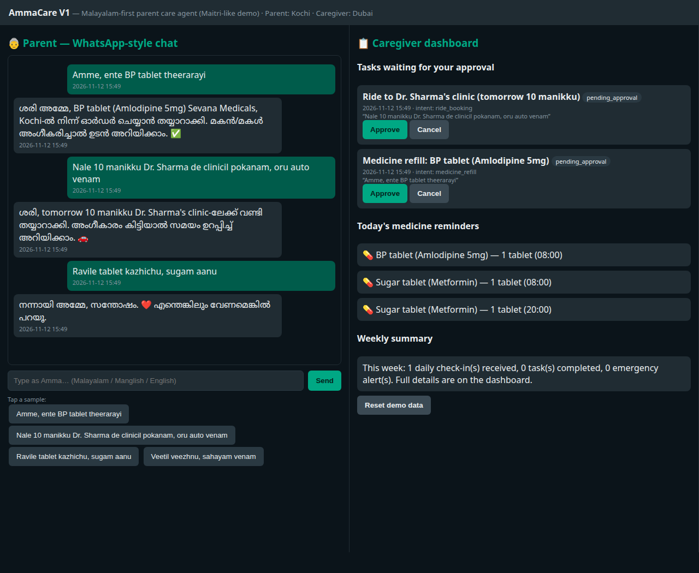
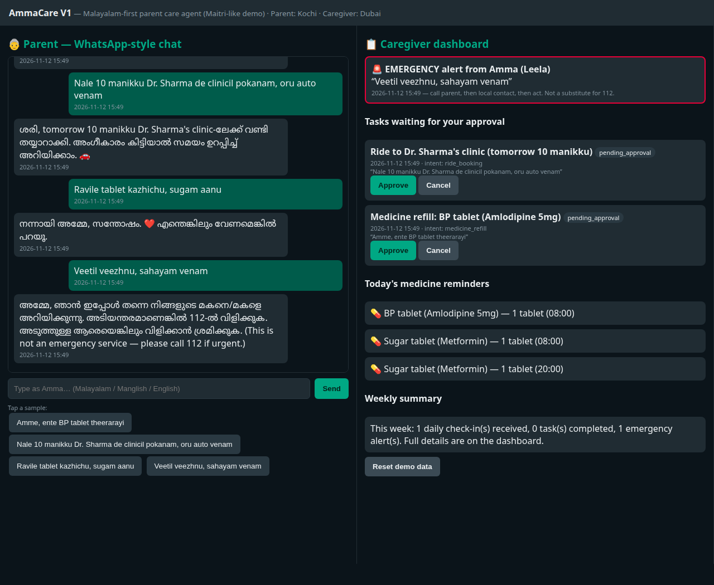

# AmmaCare — NRI Parent Care Agent (V1, Maitri-like) -Demo

WhatsApp-style AI assistant for elderly parents in Kerala, Malayalam-first.
Built for a ₹0 budget: Python standard library only, no paid APIs, no API key needed to run the demo.

## What V1 does (like Maitri)
1. Parent sends a text / (simulated) voice-note transcript in Malayalam, Manglish, or English.
2. The agent understands the intent and **prepares a task** — it never spends money or books anything on its own.
3. The caregiver (son/daughter abroad) sees the task on a dashboard and **approves / modifies / cancels** it.
4. Smart medicine reminders from the parent's profile.
5. Emergency keyword detection → instant caregiver alert + safety reply to the parent.
6. Memory: last medicine order, preferred pharmacy, regular doctor/clinic.

## V1.5 — voice notes (ready, needs a free key to go live)
`app/voice.py` transcribes a parent's Malayalam voice note with Groq Whisper
(free tier, no card: 2,000 requests/day, 8 audio-hours/day, 25 MB/file) and
feeds the transcript straight into the V1 agent brain — approval-first,
unchanged. Without a key it refuses cleanly and typed text keeps working.
Set `GROQ_API_KEY` (free key from console.groq.com) to try it. Tests:
`python3 tests/test_voice.py` (12 checks, mocked Groq, no key/network needed).
Caveat: Whisper Malayalam accuracy is moderate — test on real parent voice
notes, and try `language="ml"` vs auto-detect for Manglish.

## Parked for V2 (do NOT build yet)
Kerala bill admin (KSEB / water / property tax), Google Sheets backbone, real WhatsApp Cloud API,
local pharmacy/lab partner coordination, weekly Sunday report automation.

## Demo screenshots

Parent chat (left) and caregiver approval dashboard (right) — Amma asks in Manglish,
the agent replies in Malayalam and prepares tasks; nothing is booked or bought until
the family in Dubai approves.



Emergency flow — a fall/help message fires an instant alert on the caregiver dashboard
and a safety reply to the parent (call 112 — the agent is not an emergency service).



## Run the demo
```bash
cd nri-parent-care
python3 app/server.py
# open http://localhost:8765
```
Left side = parent's WhatsApp-style chat. Right side = caregiver dashboard.

Try these messages as the parent:
- `Amme, ente BP tablet theerarayi` (medicine refill)
- `Nale 10 manikku Dr. Sharma de clinicil pokanam, oru auto venam` (ride)
- `Veetil veezhnu, sahayam venam` (emergency test)
- `Ravile tablet kazhichu, sugam aanu` (check-in / medicine taken)

## Safety rules (non-negotiable)
- This is NOT an emergency service and NOT a doctor. In a real emergency call 112.
- The agent never changes a medicine dose and never diagnoses.
- Every purchase/booking needs caregiver approval first.

## Structure
- `app/agent.py` — agent brain: intent classification, task prep, reminders, emergency detection (offline, rule-based; optional LLM hook via `GROQ_API_KEY` / `GEMINI_API_KEY` env vars later)
- `app/store.py` — tiny JSON store: family profile, tasks, alerts, check-ins, memory
- `app/server.py` — stdlib web server + JSON API
- `app/static/index.html` — parent chat + caregiver dashboard UI
- `tests/test_agent.py` — flow tests
